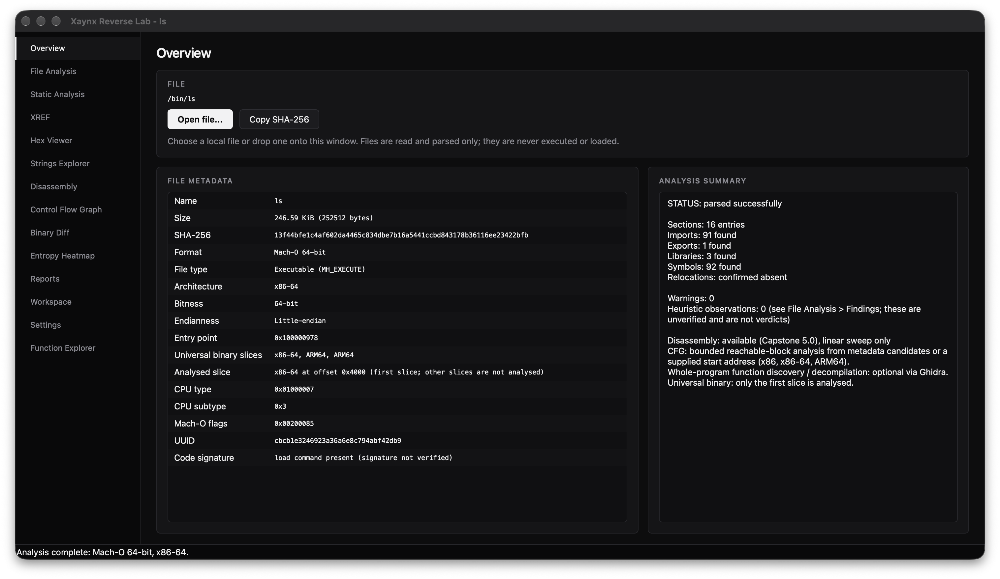

# Xaynx Reverse Lab

[](https://github.com/Xaynxofficial/xaynx-reverse-engineering/actions/workflows/ci.yml)
[](LICENSE)
[](https://en.wikipedia.org/wiki/C%2B%2B20)
[](https://www.qt.io/)

Xaynx Reverse Lab is a C++20 and Qt 6 desktop workbench for inspecting PE, ELF, and Mach-O files without executing them. It brings binary metadata, disassembly, control-flow analysis, cross-references, strings, entropy, and binary comparison into one local workflow.

The application includes a 64-bit Hex Viewer, Capstone-backed disassembly, CFG and XREF explorers, an entropy heatmap, streamed string extraction, binary comparison, explainable static-analysis observations, and an optional Ghidra integration.



> [!IMPORTANT]
> **Preview:** Built and 164 tests passed on macOS. Windows and Linux are not yet tested. [CI status](https://github.com/Xaynxofficial/xaynx-reverse-engineering/actions). Files are analyzed statically and never executed.

## Documentation

GitHub renders this `README.md` on the repository home page. The other Markdown guides are available in [`docs/`](docs/); open a link below or browse the folder.

| Guide | What it covers |
| --- | --- |
| [Documentation index](docs/README.md) | A directory of the project guides. |
| [Architecture](docs/architecture.md) | Components, data flow, analysis engines, and implementation boundaries. |
| [Analysis notes](docs/analysis-notes.md) | Heuristic policy, evidence interpretation, entropy, and limitations. |
| [Ghidra setup](docs/ghidra.md) | Optional headless Ghidra integration and configuration. |
| [Packaging](docs/packaging.md) | macOS and Windows deployment guidance. |

## Contents

- [Supported systems and binary formats](#supported-systems-and-binary-formats)
- [Features](#features)
- [Build instructions](#build-instructions)
- [Command-line usage](#command-line-usage)
- [Tests](#tests)
- [Entropy formula and limitations](#entropy-formula-and-limitations)
- [License](#license)

---

## Supported Systems and Binary Formats

The project has build instructions and CI configuration for macOS and Windows. Linux is a build target, but has no CI job yet. Platform support should be considered **verified only after that platform's build and tests complete successfully**; see the preview status above.

| Format | Architectures | Features Parsed |
| :--- | :--- | :--- |
| **PE / PE32+** (Windows) | x86, x86-64, ARM, ARM64, Thumb-2, MIPS, RISC-V | DOS/COFF headers, sections, virtual/raw mappings, permissions, entry point, imports/exports, COFF symbols and section relocations, base relocations, and CodeView RSDS PDB identity (path/GUID/age; PDB contents are not loaded). |
| **ELF / ELF64** (Linux) | x86, x86-64, ARM, AArch64, MIPS, PowerPC, RISC-V | Identification headers (32/64 bit, endianness), program/section headers, `.dynsym` / `.symtab`, `.rel*` / `.rela*` relocation records, `.dynamic` libraries, GNU build ID/debuglink, and DWARF section presence (no full DWARF decoding). |
| **Mach-O** (macOS) | x86-64, ARM64, Universal Fat Binaries (multi-slice) | 32/64-bit headers, load commands (`LC_SEGMENT_64`, `LC_LOAD_DYLIB`, `LC_SYMTAB`, `LC_MAIN`, `LC_UUID`, `LC_CODE_SIGNATURE`), section relocations, section permissions, symbols, and fat slice offsets. |

---

## Features

- **Safe Binary Parsing**: Every read is validated through an arithmetic bounds checker (`xrl::Reader`) preventing integer overflow, out-of-bounds reads, or memory corruption.
- **Strict Limit Enforcement**: The executable-format parser's in-memory file cap defaults to 512 MiB; section counts (4096), load commands (16,384), and symbols (200,000) are also bounded. Entropy analysis uses a separate buffered streaming pass and retains one result per block.
- **64-bit Hex & ASCII Viewer**: Smooth, custom-painted virtual viewport with direct offset jump navigation (`0x...` or decimal) and bidirectional address/virtual offset correlation.
- **Multi-Architecture Disassembly**: Capstone linear sweep decoding across x86, x86-64, ARM, ARM64, Thumb, MIPS, PowerPC, and RISC-V. Automatically resolves start points from the entry point, executable sections, or exported functions.
- **Neutral Heuristic Observations**: Flags RWX sections, truncated section boundaries, Shannon entropy $\ge 7.2\text{ bits/byte}$, and process injection APIs without making accusatory malware claims.
- **Binary Diff & Comparison Engine**: High-performance byte-level delta detection (modified, inserted, deleted spans) with synchronized dual hex viewing, next/prev difference navigation, and structural executable metadata comparison (sections, sizes, permissions, imports, exports, libraries).
- **Entropy Heatmap & Analysis**: Streamed Shannon entropy for configurable blocks (256-byte default), overall and per-block statistics, SHA-256, A/B distribution comparison, variation highlighting, Hex Viewer navigation, cancellation, progress, JSON reports, and block CSV export.
- **Advanced Strings Explorer**: Buffered extraction of ASCII, UTF-8, UTF-16 LE, and UTF-16 BE strings; configurable minimum length; byte-accurate offsets; transparent pattern-based classification; filtering and sorting; Hex Viewer range highlighting; cancellation, progress, JSON, and CSV export.
- **Explainable Static Analysis**: Local evidence-based findings combine the existing parser, Strings Explorer, Entropy Heatmap, and (when already analyzed) CFG. Every finding includes its rule, evidence, confidence, benign explanations, and recommended next step; correlations are shown separately and never add risk points.
- **Control Flow Graph & Program Flow Analyzer**: Capstone-backed reachable CFG construction for x86, x86-64, and ARM64; metadata-backed, executable-section-start, or user-specified entry addresses; basic blocks, branch/call resolution, dominators, loop/SCC metrics, complexity, graph navigation, and JSON/DOT export.
- **Cross-Reference Engine (XREF)**: Bounded, CFG-backed indexing of confirmed direct calls and branches, statically resolved data targets, exact-address symbol/import/export matches, and string-start references; includes incoming/outgoing indexes, caller/callee metrics, unresolved indirect-call reporting, navigation, and JSON/CSV/DOT export.
- **Relocation and Debug Identifiers**: Parses PE COFF/base relocations, ELF REL/RELA entries, Mach-O section relocations, and available CodeView, GNU build ID/debuglink, DWARF-presence, and Mach-O UUID metadata. These records feed XREF and the Function Explorer; external symbol files are not fetched or decoded.
- **Function Explorer**: Lists parser-backed entry-point, export, function-symbol, and executable-section-start candidates with evidence labels and same-file XREF call metrics when available. Provides direct navigation to CFG, disassembly, and mapped Hex Viewer offsets, plus relocation and debug-identifier tables.
- **Analysis Workspace**: Persistent local investigation projects with binary references, SHA-256 identity checks, analysis and diff history, notes, bookmarks, tags, session restoration, and JSON metadata backup/restore.
- **RFC 8259 Structured Reports**: Export comprehensive inspection and comparison data to schema-validated JSON or formatted plain text.
- **Decoupled Ghidra Integration**: Optional headless background analysis using `analyzeHeadless` and `ghidra_scripts/XrlExport.java` to extract real Ghidra function listings and decompiled C code. Ghidra is never required for core operation.

---

## User Interface

The desktop interface uses a minimalist, low-fatigue charcoal/black aesthetic:
- **Sidebar**: Quick navigation across *Overview*, *File Analysis*, *Static Analysis*, *XREF*, *Hex Viewer*, *Strings Explorer*, *Disassembly*, *Control Flow Graph*, *Binary Diff*, *Entropy Heatmap*, *Reports*, *Analysis Workspace*, *Settings*, and *Function Explorer*.
- **Drag-and-Drop**: Drop any executable directly onto the window for instant parsing.
- **Synchronized Binary Diff**: Compare any two binary files side-by-side with synchronized scrolling, color-coded byte difference highlighting (modified, inserted, deleted), difference stepping (`[Previous Diff]`, `[Next Diff]`), and an interactive metadata change table with double-click navigation.
- **Interactive Entropy Heatmap**: Grid-based, zoomable block view; hover for byte range, size, and entropy; select a block to navigate the Hex Viewer when File A is the currently loaded file. Optional File B compares aligned block distributions and highlights threshold-level changes.
- **Strings Explorer**: Set a minimum character count, extract from the currently loaded file, then search results by literal text, category, or encoding; toggle case sensitivity and sort each column. Selecting a result highlights its exact source bytes in the Hex Viewer when the same file is available in memory. JSON and CSV exports include value, byte offset, byte length, encoding, and classifications.
- **Static Analysis**: Open the *Static Analysis* page and analyze the loaded PE, ELF, or Mach-O file. The cancellable background job reuses Strings Explorer, Entropy Heatmap, or CFG results only when they belong to the same file; otherwise it runs the existing string/entropy engines and excludes data whose SHA-256 no longer matches the loaded file. Search/filter findings, inspect their evidence and alternative benign explanations, open the related analysis view, or export a self-contained JSON or escaped HTML report.
- **Control Flow Graph**: Choose an executable entry point, export/function symbol, or provide an address within an executable section, then analyze reachable control flow. Pan, zoom, fit, search block addresses, inspect branch/call details, and jump to a selected block in disassembly or the Hex Viewer. Export the graph as JSON or Graphviz DOT.
- **XREF Explorer**: Build an index for the loaded file from the *XREF* page. Search addresses, function/symbol names, and string text; filter by reference type and incoming/outgoing direction; inspect source and destination addresses, offsets, evidence, and confidence; and explore a bounded, zoomable relationship graph. Select a reference to navigate to its instruction, mapped Hex Viewer location, CFG function, or matched string. Export the indexed references as JSON or CSV, or export a bounded Graphviz DOT relationship graph.
- **Filterable Tables**: Instantly search sections, imported symbols, exported APIs, linked libraries, or disassembly listings with case-insensitive column filtering.
- **Double-Click Linking**: Double-click any section, instruction, or metadata difference in the tables to jump directly to its raw offset in the Hex Viewer.

---

### Strings Explorer usage and limitations

Open a file in the application, select **Strings Explorer**, choose the minimum number of Unicode characters, and press **Extract strings**. Extraction runs in a cancellable background worker. Filter completed results with the search field, category and encoding menus, the case-sensitivity toggle, and sortable columns. Click a result to navigate to and highlight its byte range in the Hex Viewer when the file is loaded there.

The scanner reads in 64 KiB chunks and carries decoder state across chunk boundaries. It recognizes printable ASCII and valid UTF-8 sequences, and scans both byte alignments for UTF-16 LE/BE. Defaults cap output at 100,000 results, 32 MiB of retained string text, and 1 MiB per string; reaching an output cap is reported as truncated. Minimum length counts decoded characters, while table lengths and offsets refer to original bytes. Regular expressions are not enabled; search is literal text over extracted results.

Classification uses explicit, deterministic patterns: URL schemes, IPv4 literals, email-like values, domain labels, common absolute file-path forms, Windows registry root prefixes, library filename suffixes, a small common-API name set, and `%NAME%` / `$NAME` environment references. These rules can produce false positives and miss unusual forms. UTF-16 byte sequences can also be ambiguous, and binary data may coincidentally decode as printable text. A detected string or category does not prove that the program uses, contacts, or executes it, and is not a security verdict.

### Control Flow Graph usage and limitations

Open a supported executable once from **File Analysis** or **File → Open**. **Binary Diff** automatically uses it as File A, and **Entropy Heatmap** automatically uses it as File A; choose only File B when you want a comparison. In **Control Flow Graph**, choose a discovered entry point/export/function symbol or, when metadata has none, the listed executable-section start. You can also enter a virtual address or file offset mapped to an executable section. The analyzer follows reachable instructions and reports basic blocks, conditional and direct branches, calls, unresolved indirect flow, reachability, dominators, loop/SCC metrics, and cyclomatic complexity. Select a block to inspect its instructions; use the graph controls to navigate and to synchronize with disassembly or the Hex Viewer. JSON and Graphviz DOT exports preserve the evidence and truncation status.

CFG decoding is supported only for x86, x86-64, and ARM64. A function-start symbol confirms a start address, not the function's end; entry points and user-provided addresses are candidates rather than proof of function boundaries. Indirect branches and calls without resolvable immediate targets remain explicitly unresolved, and calls are recorded as call references rather than drawn as intraprocedural edges. Analysis is bounded by per-block byte/instruction limits, a total decode budget, and a maximum block count; a graph that reaches a limit is marked truncated. Metrics describe the decoded reachable graph only. The analyzer does not execute target files, infer dynamic behavior, or label files malicious.

### Function Explorer usage and limitations

Open **Function Explorer** after loading a binary. The Functions table lists metadata-backed entry points, exports, function symbols, and (when those are absent) executable-section starts. The evidence and boundary columns distinguish confirmed starts from candidates. Incoming/outgoing call counts, call depth, recursion, and unresolved indirect-call counts appear only when an XREF result for the same SHA-256 is available; candidates omitted from the bounded XREF index are marked as not indexed. Select a row to analyze it in CFG, disassemble from its mapped file offset, or navigate to that offset in the Hex Viewer. Relocations and parsed debug identifiers are available in the other tabs.

This is not whole-program function discovery: stripped binaries may yield only section starts, and section starts/entry points do not establish real function boundaries. CFG navigation is available only for x86, x86-64, and ARM64 builds with Capstone; disassembly depends on the architecture support compiled into Capstone. PE PDB identity, ELF debuglink/build ID and DWARF section presence, and Mach-O UUID are identifiers/metadata only. The application does not search for, load, download, or decode external PDB/dSYM/debug files, and it does not perform full DWARF decoding. Relocation file offsets or symbol targets are left unavailable when the parser cannot map them reliably.

### Cross-Reference Engine usage and limitations

Open a supported PE, ELF, or Mach-O file, select **XREF**, and choose **Build XREF Index**. Indexing runs in a cancellable background job and reuses the existing Capstone disassembler and CFG analyzer. The page provides searchable/filterable references, incoming and outgoing views, unresolved indirect-call entries, candidate function/string tables, and a bounded relationship graph. Selecting a reference offers navigation to its disassembly instruction, a valid mapped Hex Viewer offset, its CFG function, or the exact matched string. JSON and CSV contain the reference records; Graphviz DOT exports a node- and edge-bounded relationship graph.

Code indexing supports x86, x86-64, and ARM64, matching the existing CFG engine. Direct calls and conditional/unconditional branches come from decoded CFG instructions. Statically resolved memory targets are limited to supported x86/x86-64 absolute and RIP-relative operands and ARM64 ADR targets; other immediate values, register-state propagation, and unresolved indirect targets are not guessed. Parser-provided import, export, symbol, and relocation records are linked using only recorded address/symbol evidence; unresolved relocation targets remain unresolved. A string reference is reported only when a resolved target maps to the exact starting file offset of a string extracted from the same file identity. File offsets are omitted when virtual-to-file mapping is unavailable.

Function discovery is limited to parser-provided entry points, exports/function symbols, and executable-section starts; stripped binaries can therefore have incomplete coverage, and candidate starts do not establish true function boundaries. Function call depth, recursion, and unreferenced candidates describe only the bounded index and are heuristic; an unreferenced function is not necessarily dead code. Direct call targets outside discovered function candidates remain address references without an invented callee. Debug identifiers are parsed as metadata, but external symbol-file loading, indirect-call resolution, and SVG export are not implemented. Analysis is capped at 256 function candidates, 200,000 references, 512 CFG blocks per candidate, and 64 MiB total CFG decoding by default; reaching a bound is reported as truncation. DOT export defaults to 256 nodes and 2,000 edges. The engine is static and local: it does not execute files or infer dynamic behavior.

### Analysis Workspace usage and limitations

Open **Analysis Workspace** to create and organize investigation projects. Add the currently loaded binary or choose another file; projects retain its original path and SHA-256 identity, not a copy of the binary. When reopening a reference, the application checks the file hash before treating it as the same binary. A changed file requires explicit confirmation before its project reference is updated; prior reports, notes, and bookmarks remain associated with the previous hash. Missing binaries can be located again from the Files tab.

The workspace saves project descriptions/categories, binary references, analysis and Binary Diff report snapshots, notes, bookmarks, tags, the active project, selected binary, active page, and selected byte offset. It reloads the last selected binary when available. Create a JSON metadata backup with **Back up workspace**; **Restore backup** adds imported projects as new projects and never replaces existing projects. Backups do not include source binaries.

Workspace data is stored locally under the platform's Qt `AppDataLocation` in `workspace/workspace.json`; on Unix-like systems the workspace directory is restricted to the current user. The versioned JSON format includes a SHA-256 integrity checksum to detect accidental modification or corruption; it is not an authenticity signature. Schema v1 data is migrated when loaded. Individual report snapshots are limited to 8 MiB and the complete workspace to 64 MiB. If stored data cannot be validated, it is left untouched and the UI offers recovery through a valid backup. Session restoration does not persist in-memory analysis engines such as the CFG/XREF graph state; those analyses can be rerun from their respective pages.

### Explainable Static Analysis usage and limitations

Run **Analyze Current File** on an already loaded PE, ELF, or Mach-O file. Analysis runs locally in the background and can be cancelled. Findings are searchable and filterable by severity and category; selecting one shows the rule ID, evidence offsets/addresses, confidence, evidence quality, benign explanations, and next steps. **Open related view** navigates to the relevant existing section, imports, strings, entropy, CFG, or hex page. The JSON report preserves findings, warnings, correlations, scoring method, and limitations; the HTML report is suitable for human review.

The current deterministic rules report invalid parsed section ranges, writable-and-executable regions, virtual/raw section gaps of at least 1 MiB, entry points outside mapped executable data, recognized import capability groups, classified strings, command-line-like string fragments, high-entropy executable sections/blocks (at least 7.2 bits/byte), and selected CFG complexity/unresolved-edge indicators. Correlations cover writable/executable regions with process-control imports, high-entropy executable sections with large virtual/raw gaps, and network imports with URL/domain/IPv4-like strings. These are associations, not proof that indicators are connected at runtime.

The evidence score is a prioritization aid, **not malware probability or a maliciousness verdict**. Finding weights are informational 0, low 8, medium 18, high 32, and critical 45; candidate points equal weight × confidence × evidence quality (both percentages). Only the highest contribution for each evidence group is counted, correlations add no points, and the total is rounded and capped at 100. The report marks the score inconclusive unless at least two independent positive-weight evidence groups contribute.

Parser metadata and the loaded byte snapshot are reused. String and entropy results are reused only when file path and SHA-256 match; if the on-disk file changes while those analyses run, their findings are excluded with a warning. CFG rules are evaluated only for a valid result previously produced by the CFG workflow; static analysis does not automatically scan every function. Relocation records and debug identifiers are parsed and shown in the Function Explorer/XREF, but are not yet evidence inputs to the static-analysis rules. The parser's in-memory file limit is 512 MiB. Findings are capped at 600 and string evidence is capped at 250 examples per category. Imports may be unused, strings may be dead/documentary data, and entropy may reflect benign compression or assets; inspect the evidence and limitations before drawing conclusions.

## Prerequisites

- **C++ Compiler**: Clang 15+, AppleClang 14+, GCC 12+, or MSVC 2022 (with `/std:c++20`).
- **CMake**: Version 3.21 or higher.
- **Qt 6**: Version 6.2 or higher (`qtbase` with `Widgets` and `Concurrent`).
- **Capstone**: Version 5.0 or higher.
- **GoogleTest**: Version 1.12+ (automatically downloaded via `FetchContent` if not found locally).

---

## Build Instructions

### macOS (Homebrew)

1. Install prerequisites:
   ```bash
   brew install cmake capstone googletest qtbase
   ```

2. Configure and build:
   ```bash
   cmake -S . -B build \
     -DCMAKE_BUILD_TYPE=Release \
     -DXRL_BUILD_GUI=ON \
     -DXRL_BUILD_TESTS=ON \
     -DXRL_BUILD_CLI=ON \
     -DCMAKE_PREFIX_PATH="/opt/homebrew;/opt/homebrew/opt/qtbase"

   cmake --build build -j$(sysctl -n hw.ncpu)
   ```

3. Run the test suite:
   ```bash
   ctest --test-dir build --output-on-failure
   ```

4. Launch the application:
   ```bash
   open "build/src/ui/Xaynx Reverse Lab.app"
   ```

---

### Windows (MSVC 2022 + vcpkg)

1. Install dependencies with `vcpkg`:
   ```powershell
   vcpkg install capstone:x64-windows gtest:x64-windows
   ```

2. Ensure Qt 6.2+ is installed (e.g. via the Qt Online Installer or GitHub action) and in `CMAKE_PREFIX_PATH`.

3. Configure and build:
   ```powershell
   cmake -S . -B build `
     -G "Visual Studio 17 2022" -A x64 `
     -DCMAKE_BUILD_TYPE=Release `
     -DXRL_BUILD_GUI=ON `
     -DXRL_BUILD_TESTS=ON `
     -DXRL_BUILD_CLI=ON `
     -DCMAKE_TOOLCHAIN_FILE="$env:VCPKG_ROOT\scripts\buildsystems\vcpkg.cmake"

   cmake --build build --config Release --parallel
   ```

4. Run the test suite:
   ```powershell
   ctest --test-dir build --output-on-failure -C Release
   ```

5. Launch the executable:
   ```powershell
   .\build\src\ui\Release\xaynx-reverse-lab.exe
   ```

---

### Linux (Debian / Ubuntu)

Linux has not been tested yet. Install the build dependencies:

```bash
sudo apt update
sudo apt install build-essential cmake qt6-base-dev libcapstone-dev libgtest-dev
```

Configure, build, and run tests:

```bash
cmake -S . -B build \
  -DCMAKE_BUILD_TYPE=Release \
  -DXRL_BUILD_GUI=ON \
  -DXRL_BUILD_TESTS=ON \
  -DXRL_BUILD_CLI=ON

cmake --build build --parallel
ctest --test-dir build --output-on-failure
```

Launch the desktop app:

```bash
./build/src/ui/'Xaynx Reverse Lab'
```

---

## Command-Line Usage

For automated pipelines, continuous integration, or headless scripting:

```bash
# Generate plain text report to stdout
./build/xrl-cli /bin/ls

# Generate structured JSON report
./build/xrl-cli sample.exe --json report.json

# Disassemble 50 instructions from entry point
./build/xrl-cli /bin/ls --disasm --count 50

# Disassemble from a specific file offset
./build/xrl-cli sample.bin --disasm 0x1000 --count 100

# Compare two binaries at byte and executable metadata level (stdout summary)
./build/xrl-cli --diff baseline.exe patched.exe

# Export structured JSON comparison report
./build/xrl-cli --diff baseline.bin patched.bin --json diff_report.json
```

---

## Tests
The comprehensive test suite in `tests/` covers:
- Valid PE32+, ELF32/64, and Mach-O (thin and universal multi-slice) synthetic fixtures.
- Corrupted and invalid magic bytes (`MZ` without PE, non-ELF, fake universal headers).
- Truncated headers and section tables.
- Out-of-bounds raw file offsets and virtual sizes exceeding physical boundaries.
- Empty files and oversized inputs exceeding configured limits.
- FIPS 180-4 SHA-256 test vectors and chunk streaming.
- Shannon entropy mathematical precision and streamed block analysis: empty and zero-filled files, repeated bytes, uniform byte distributions, incomplete blocks, large inputs, invalid paths, cancellation, and JSON/CSV exports.
- String extraction: ASCII, UTF-8, UTF-16 LE/BE, exact offsets and byte lengths, buffer-boundary crossings, minimum lengths, duplicate spans, pattern classifications, large files, output limits, invalid paths, cancellation, progress, and JSON/CSV exports.
- Binary Diff & Comparison: identical buffers/files, single-byte deltas, insertions, deletions, disjoint changes, size mismatches, unreadable files, metadata additions/removals/modifications, and structured JSON report schema.
- XREF: direct calls, conditional/unconditional branches, RIP-relative data and exact string targets, imports/exports, recursion, unresolved indirect calls, stripped metadata, configured limits, cancellation, large reference indexes, and JSON/CSV/DOT export bounds.
- Analysis Workspace: project and binary CRUD, duplicate detection by SHA-256, notes/bookmarks/tags/history persistence, schema migration, checksum tamper detection, invalid data rejection, and backup/restore serialization.
- Bounds validation under AddressSanitizer (ASan) and UndefinedBehaviorSanitizer (UBSan).
- RFC 8259 JSON parser edge cases (deep nesting, surrogate pairs, malformed tokens).
- Neutral wording verification for heuristic outputs.

## Entropy Formula and Limitations

For a block with byte-value probabilities $p_i$, Shannon entropy is
$H=-\sum_{i=0}^{255}p_i\log_2(p_i)$, measured in bits per byte (0–8). Each block
is calculated independently; the overall file entropy is calculated from the
whole-file byte distribution. The average block entropy is the unweighted
arithmetic mean of the per-block values. Empty files have no defined entropy
statistics (shown as unavailable), though their SHA-256 is still reported.

Entropy describes byte-value distribution, not meaning or intent. Compression,
encryption, packed executable sections, and many benign formats can all have
high entropy; small blocks also produce noisier estimates. Entropy is not a
malware classifier and should be interpreted alongside other evidence. The
heatmap's comparison pairs blocks at equal file offsets and omits unmatched
trailing blocks. Streaming avoids loading the entire input, but the per-block
results are kept in memory, so very large files combined with small block sizes
can require substantial memory.

---

## License

This project is licensed under the permissive **MIT License**. See [LICENSE](LICENSE) for details.
Libraries used: Capstone (BSD), Qt 6 (LGPLv3), GoogleTest (BSD-3-Clause).
